<!--
  ⚡ COMPILED BY GHPX (GitHub Profile eXperience) v1.0
  Template: cinematic-os
  Architecture: Zero-JS SVG Vector Shaders + HTML5 
 Exclusive State Machines
-->

  <a href="https://pourya.space">
    <picture>
      
    </picture>
  </a>

 

<picture>
  
</picture>

<picture></picture>

 
<picture></picture>

  <a href="https://pouryaak.github.io/wobnimo/"><picture></picture></a>&nbsp;&nbsp;<a href="https://github.com/Pouryaak/wobnimo"><picture></picture></a>&nbsp;&nbsp;<a href="https://www.npmjs.com/package/wobnimo"><picture></picture></a>

 

<picture></picture>

 
<picture></picture>

  <a href="https://github.com/Pouryaak/lokul"><picture></picture></a>&nbsp;&nbsp;<a href="https://pourya.space"><picture></picture></a>

 

<picture></picture>

 
<picture></picture>

  <a href="https://pouryaak.github.io/LokulMem/"><picture></picture></a>&nbsp;&nbsp;<a href="https://github.com/Pouryaak/LokulMem"><picture></picture></a>

 

 

<picture>
  
</picture>

<picture>
  
</picture>

  

<picture>
  
</picture>

<picture></picture>

 
<picture></picture>
 

<picture></picture>

 
<picture></picture>
 

 

<a href="https://pourya.space">
  <picture>
    
  </picture>
</a>

  <a href="https://pourya.space"><picture></picture></a>&nbsp;&nbsp;<a href="https://pouryaak.github.io/wobnimo/"><picture></picture></a>&nbsp;&nbsp;<a href="https://www.linkedin.com/in/pourya-akraminayeri-4230ba10b/"><picture></picture></a>&nbsp;&nbsp;<a href="mailto:pourya.akramina@gmail.com"><picture></picture></a>

